# 🚀 AI Career Assistance & Skill Roadmap Platform (Frontend)

<div align="center">


[](https://career-roadmap-assistance-edwy.vercel.app)
[](https://react.dev/)
[](https://vitejs.dev/)
[](https://tailwindcss.com/)
[](https://mui.com/)
[](https://reactrouter.com/)
[](https://axios-http.com/)
[](https://oxc.rs/)

<p align="center">
  <b>A comprehensive, AI-powered career enablement portal built for engineering students and modern tech professionals.</b><br/>
  <i>5th Semester Software Engineering Capstone Project</i><br/><br/>
  🔗 <b>Live Demo on Vercel:</b> <a href="https://career-roadmap-assistance-edwy.vercel.app"><b>career-roadmap-assistance-edwy.vercel.app</b></a>
</p>

[🌐 Live Demo](https://career-roadmap-assistance-edwy.vercel.app) •
[Key Features](#-key-features) •
[Screenshots](#-screenshots) •
[System Architecture](#-system-architecture) •
[Tech Stack](#-tech-stack) •
[Project Structure](#-project-structure) •
[Getting Started](#-getting-started) •
[API Integration](#-api-integration) •
[Admin Portal](#-admin-management-portal) •
[Academic Deliverables](#-academic--software-engineering-context)

</div>

---

## 📖 Executive Summary

The **AI Career Assistance & Skill Roadmap Platform** is an enterprise-grade web application designed to bridge the gap between academic preparation and industry tech requirements. 

Traditional job-hunting platforms overwhelm students with static listings without providing actionable guidance on skill deficiencies. This platform tackles that bottleneck by combining:
1. **Automated Resume Intelligence & ATS Scoring** powered by an AI NLP microservice.
2. **Semantic Skill Gap Analysis** comparing user competencies directly against real-world job role benchmarks.
3. **Dynamic Weekly Milestone Roadmaps** with curated video tutorials and articles.
4. **Interactive Role-Based Skill Assessments** spanning foundational CS, Cloud/DevOps, AI/ML, and Cybersecurity.
5. **Curated Learning Resource Directory** with free/paid filtering and provider badges.
6. **Role-Based Admin Control Center** for managing curriculum tracks, learning resources, and monitoring system metrics.

---

## 🌐 Live Deployment

The web application is live and hosted on Vercel:
- **Production URL**: [https://career-roadmap-assistance-edwy.vercel.app](https://career-roadmap-assistance-edwy.vercel.app)
- **Deployment Platform**: Vercel (Global Edge Network)
- **Status**: 🟢 Active & Online

---

## 🌟 Key Features

### 1. 🤖 Intelligent Resume Parsing & ATS Review
- **PDF Upload & Text Stream**: Upload resumes directly or paste raw text for analysis.
- **7-Category Skill Extraction**: Automatically parses Languages, Frameworks, Databases, Cloud & DevOps, Core CS, Tools, and Soft Skills.
- **ATS Compatibility Score**: Computes real-time match percentages against industry job descriptions.
- **Prescriptive Feedback**: Highlights resume strengths, identified critical gaps, and concrete bullet-point improvements.

### 2. 🗺️ Dynamic AI Learning Roadmaps
- **Customized Curriculum**: Generates personalized learning paths based on:
  - Target Career (e.g., *Backend Developer*, *Full Stack Engineer*, *Cloud/DevOps Engineer*, *AI/ML Engineer*).
  - Experience Level (*Beginner*, *Intermediate*, *Advanced*).
  - Duration (*4 to 24 Weeks*).
- **Weekly Milestones**: Clear, achievable weekly learning objectives with status toggles (`PENDING`, `IN_PROGRESS`, `COMPLETED`).
- **Curated Learning Links**: Integrated references to documentation, tutorials, and practice exercises.

### 3. 🔍 Semantic Career Gap Analysis
- Benchmarks the student's active skills against required career matrices.
- Visual status indicators for:
  - **Mastered Skills** (skills matching or exceeding required proficiency).
  - **Missing / Gap Skills** (required competencies the student has not yet acquired).
  - **Recommended Action Items** to achieve career readiness.

### 4. 📝 Interactive Role-Based Skill Assessments
Rigorous 15-question assessments tailored to industry hiring bars:
- **Fresher Software Engineer**: Core CS Foundations (OOP, Data Structures & Algorithms, Operating Systems, Computer Networks, DBMS).
- **Cloud & DevOps Engineer**: Containerization (Docker, Kubernetes), CI/CD pipelines, AWS/GCP architecture, Infrastructure as Code (Terraform).
- **AI / Machine Learning Engineer**: Supervised/Unsupervised learning, Deep Learning, PyTorch/TensorFlow, Model Evaluation, NLP.
- **Cybersecurity & Infosec Engineer**: Network security, Cryptography, OWASP Top 10, Authentication protocols, Vulnerability assessment.
- **Assessment Engine Features**:
  - Live countdown timer.
  - Difficulty distribution (Easy, Medium, Hard).
  - Instant score breakdown, topic-by-topic analytics, and detailed explanations for every question.
  - Retake capability with score tracking.

### 5. 📚 Curated Learning Resources Catalog
- Comprehensive library of online courses, video playlists, and technical guides.
- Providers include **Coursera**, **Udemy**, **YouTube**, **edX**, and **Official Documentation**.
- Real-time search, skill tagging, and **Free vs. Paid** filtering.
- Direct external enrollment links.

### 6. 👤 Student Profile & Skills Management
- **Academic Credentials**: College, Degree, Branch, Graduation Year, Current Semester.
- **Social & Portfolio Links**: GitHub, LinkedIn, and personal portfolio integration.
- **Skill Inventory**: Full CRUD operations for student skills with proficiency ratings (*BEGINNER*, *INTERMEDIATE*, *ADVANCED*) and years of experience.

### 7. 🛡️ Role-Based Access Control & Admin Portal
- Protected routing via `AdminRoute` and `ProtectedRoute`.
- Real-time system analytics (total users, active careers, skill catalog count, assessments taken).
- Career Management: Create new career tracks and configure required skill matrices.
- Resource Catalog Management: Ingest new courses and learning materials with provider metadata.

---

## 📸 Screenshots

### AI Roadmap Generator
Generate personalized weekly learning roadmaps by selecting a target career, experience level, and duration.

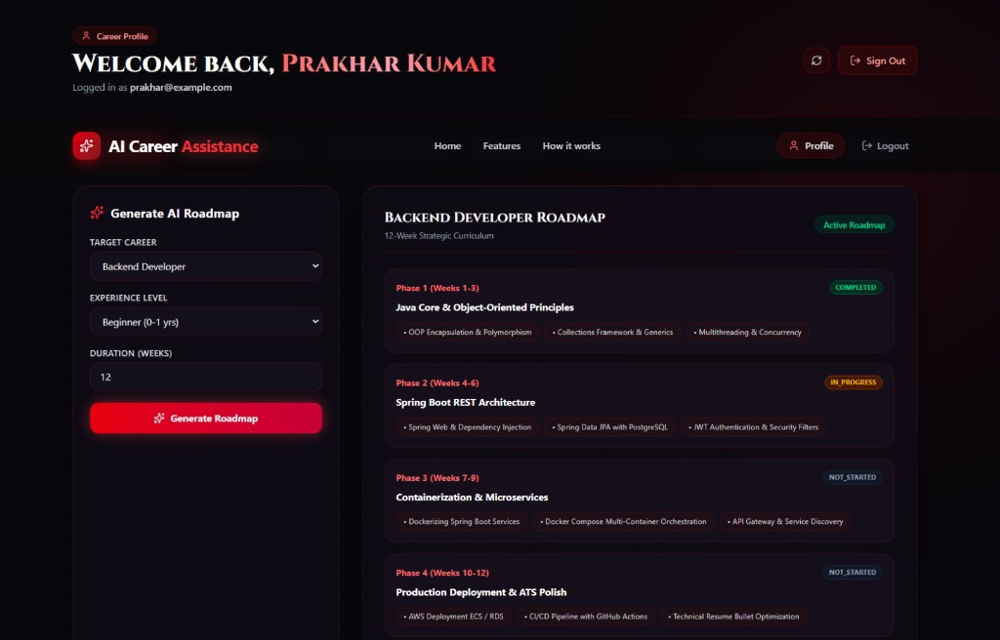

### Semantic Gap Analysis
AI-powered skill gap analysis comparing your skills against career role requirements with synergy scores and strategic recommendations.

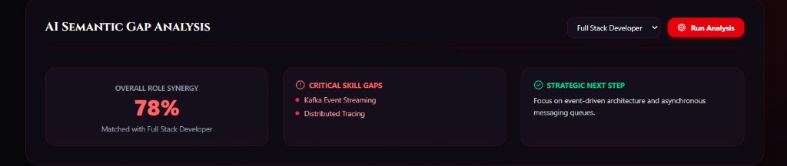

### My Skills Inventory
Add, manage, and track your technical skills with proficiency levels and years of experience.

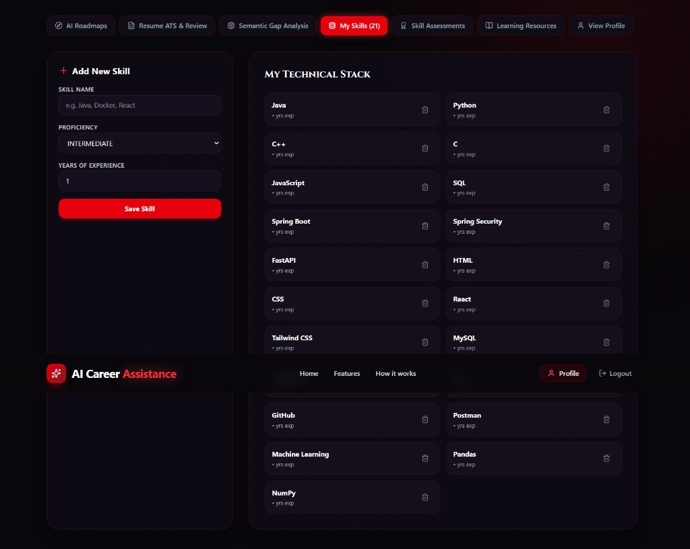

### Skill Assessments Catalog
Choose from role-based assessments (Fresher Software Engineer, Cloud & DevOps, AI/ML, Cybersecurity) with difficulty breakdowns.

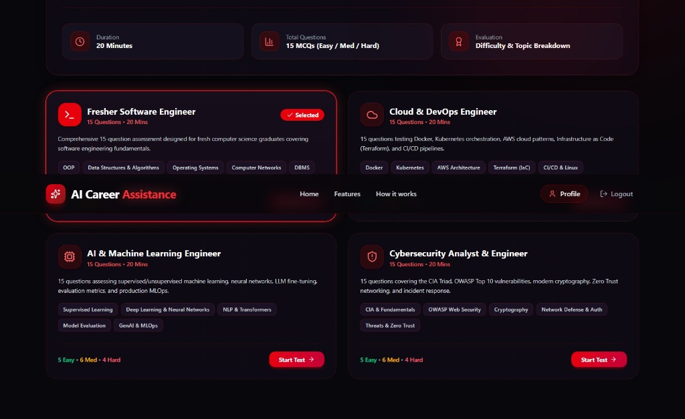

### Assessment Questions
Interactive MCQ quiz engine with difficulty tags, topic labels, and instant answer explanations.

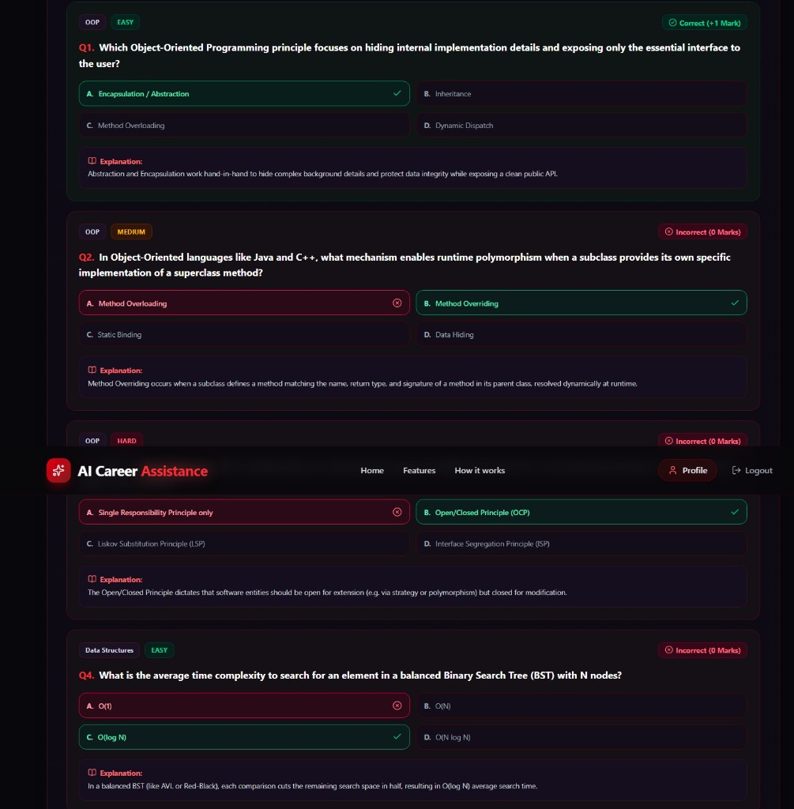

### Assessment Results
Detailed performance diagnostic report with score breakdown by difficulty, topic mastery analysis, and retake options.

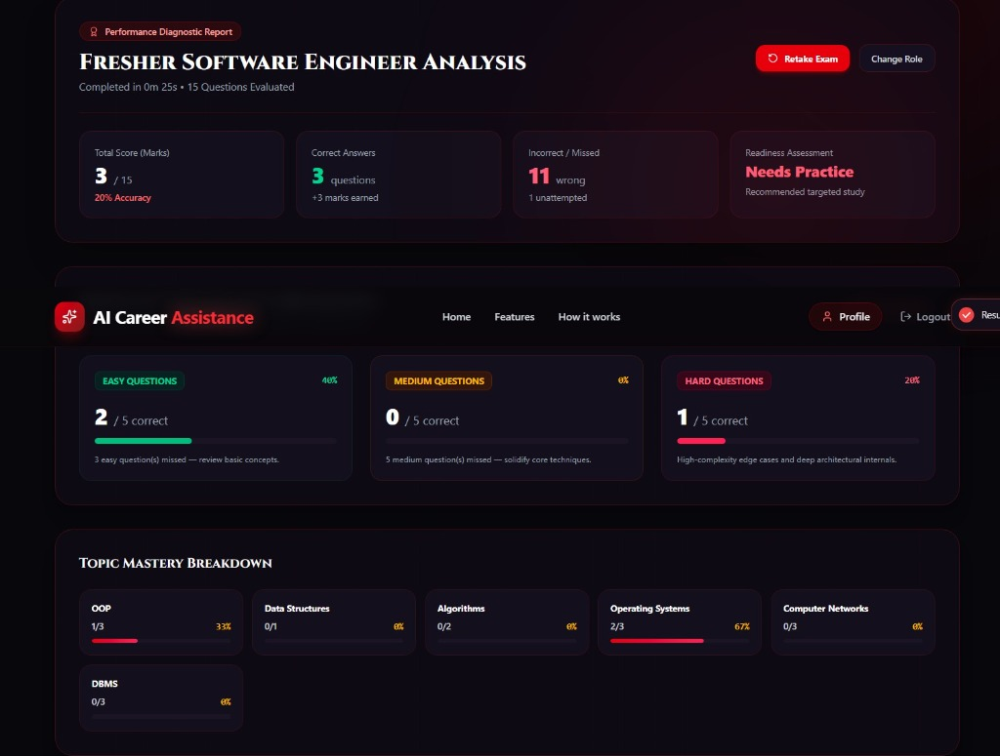

### Learning Resources
Browse and search curated courses from providers like Coursera, DeepLearning.AI, and freeCodeCamp with free/paid badges.

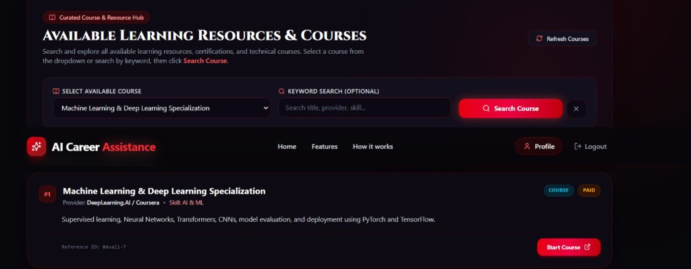

### Update Profile Form
Edit academic details, graduation year, degree, GitHub/LinkedIn URLs, and professional bio.

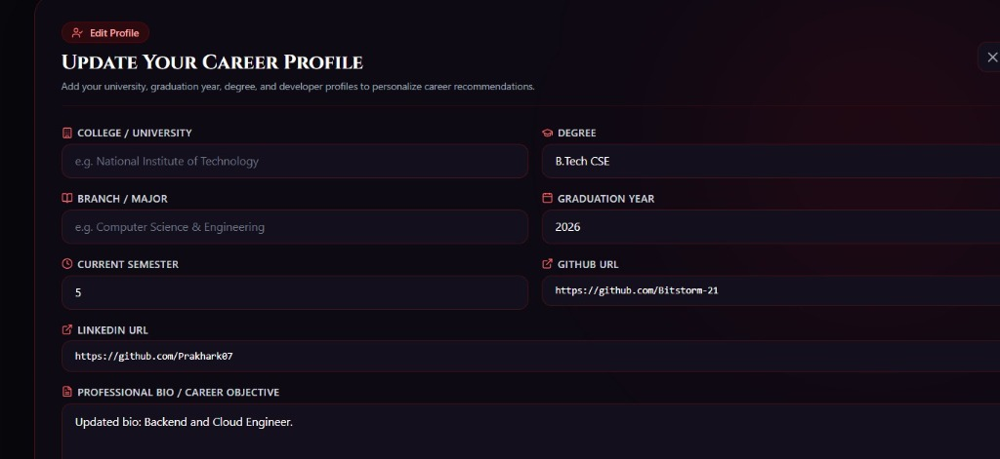

### View Profile
Student profile page showing academic background, social links, skill stats, and roadmap counts.

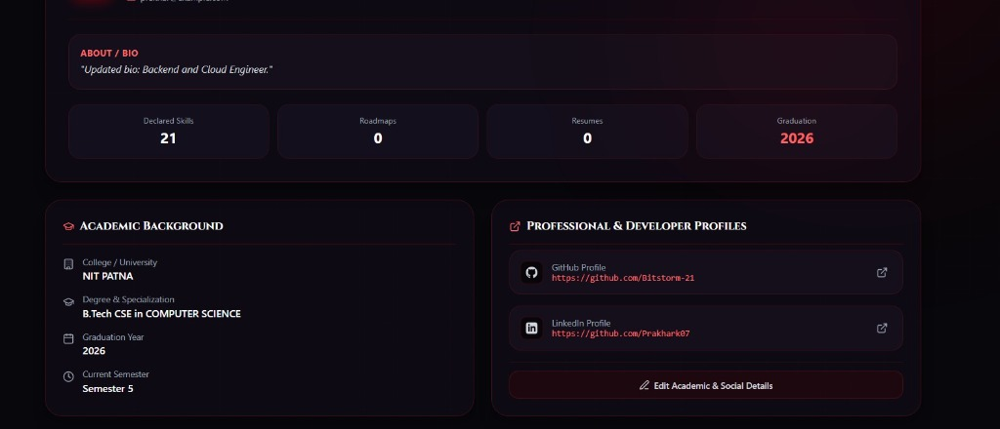

### Resume ATS Review
Upload a PDF resume or paste text to get an AI-powered ATS compatibility score with feedback and extracted skills.

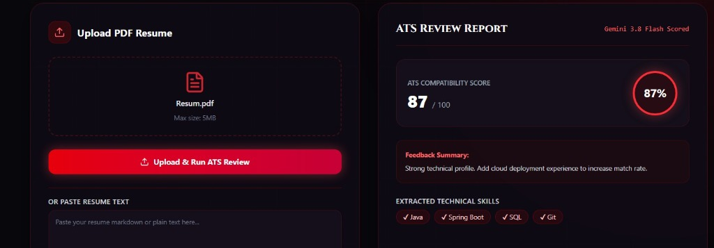

### Admin Dashboard
Admin portal with real-time platform metrics: total users, configured careers, recognized skills, assessments, and published resources.

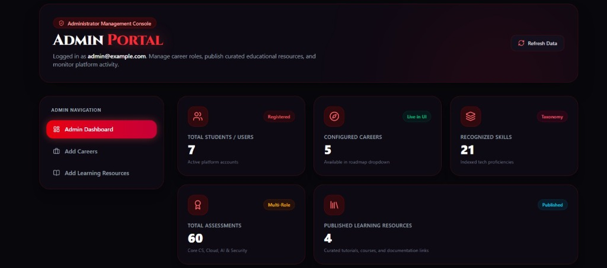

### Admin — Add Careers
Admin interface to manage career tracks with category tags, descriptions, and dynamic synchronization to the roadmap generator.

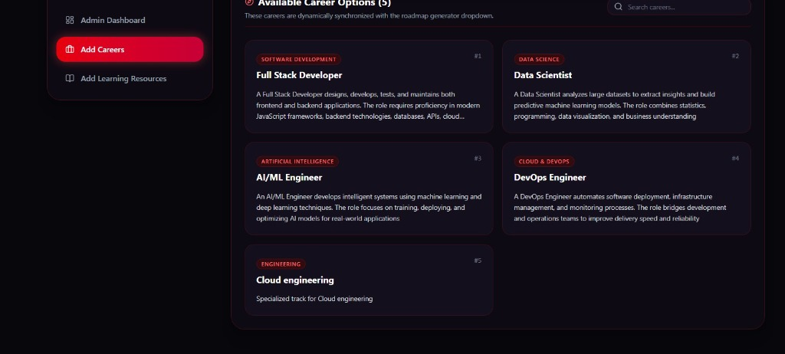

### Admin — Add Learning Resources
Admin panel to publish and manage learning resources with provider metadata, skill tags, and free/paid classification.

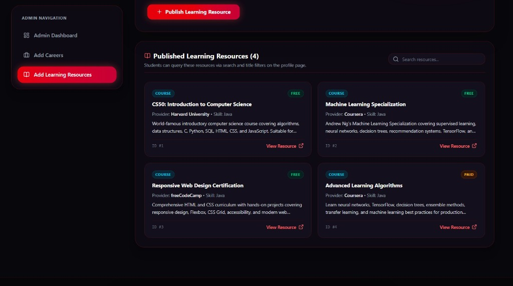

---

## 🏗️ System Architecture

The frontend application operates as the unified user presentation layer within a dual-microservice backend architecture:

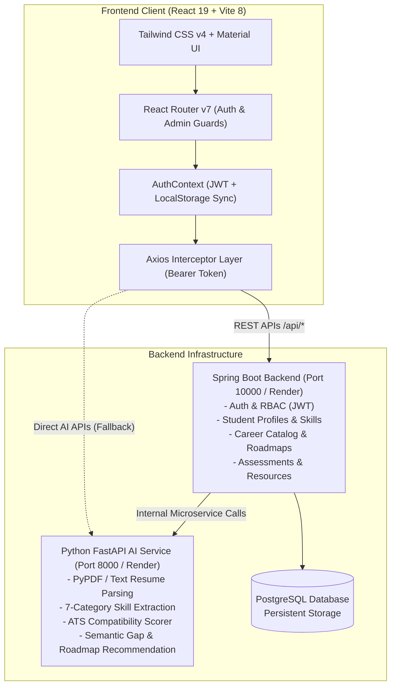

---

## 💻 Tech Stack

### Core Frontend Framework & Build System
| Technology | Version | Purpose |
| :--- | :--- | :--- |
| **React** | `^19.3.1` | Declarative UI framework with modern React 19 hooks |
| **Vite** | `^8.3.6` | Next-generation frontend tooling and sub-second HMR |
| **React Router DOM** | `^7.18.6` | Client-side routing, route protection, and navigation |
| **Oxlint** | `^1.90.0` | High-performance Rust-based JavaScript/React linter |

### Styling & Component Libraries
| Technology | Version | Purpose |
| :--- | :--- | :--- |
| **Tailwind CSS** | `^4.3.5` | Utility-first CSS engine with dark neon crimson styling |
| **@tailwindcss/vite** | `^4.3.5` | Native Vite integration for Tailwind v4 |
| **Material UI (MUI)** | `^9.5.0` | Accessible UI primitives and form components |
| **Emotion React/Styled** | `^11.14` | CSS-in-JS primitives powering MUI components |
| **Lucide React** | `^1.76.0` | Modern, clean vector iconography |
| **React Hot Toast** | `^2.6.1` | Non-blocking dark-themed notification system |

### Networking & Data Handling
| Technology | Version | Purpose |
| :--- | :--- | :--- |
| **Axios** | `^1.21.1` | HTTP client with automatic JWT token interceptor |
| **FormData API** | Native | Multipart file streaming for PDF resumes |

---

## 📁 Project Structure

```text
Software Project Frontend/
├── my-app/
│   ├── public/                      # Static assets and favicons
│   ├── src/
│   │   ├── assets/                  # High-resolution artwork & images
│   │   │   ├── hero.png             # Hero banner visual
│   │   │   ├── statue-bg.png        # Philosophy statue visual with glowing rings
│   │   │   └── media_*.md           # Backend API specifications & schemas
│   │   │
│   │   ├── components/              # Reusable UI Components
│   │   │   ├── Navbar.jsx           # Glassmorphic header with auth/admin badges
│   │   │   ├── Footer.jsx           # Dark theme footer with links & social handles
│   │   │   └── SkillAssessment.jsx  # 15-question quiz engine across 4 domains
│   │   │
│   │   ├── context/                 # Application State
│   │   │   └── AuthContext.jsx      # JWT auth, user session persistence, RBAC
│   │   │
│   │   ├── pages/                   # Top-Level Route Views
│   │   │   ├── LandingPage.jsx      # Futuristic landing page with 3-step pipeline
│   │   │   ├── LoginPage.jsx        # Glassmorphic user login with validation
│   │   │   ├── RegisterPage.jsx     # User registration with instant redirect
│   │   │   ├── DashboardPage.jsx    # Core student workspace (7 functional tabs)
│   │   │   └── AdminPage.jsx        # Admin portal for careers, resources & metrics
│   │   │
│   │   ├── services/                # API Integration Layer
│   │   │   └── api.js               # Centralized Axios clients & endpoint contracts
│   │   │
│   │   ├── App.css                  # Custom animations and scrollbar styles
│   │   ├── index.css                # Tailwind directives and custom utility classes
│   │   ├── App.jsx                  # Root router with ProtectedRoute & AdminRoute
│   │   └── main.jsx                 # Application entry point with React.StrictMode
│   │
│   ├── .env                         # Local environment configuration
│   ├── .env.example                 # Template environment variables
│   ├── .oxlintrc.json               # Oxlint rules configuration
│   ├── index.html                   # HTML template with Google Fonts (Cinzel & Inter)
│   ├── package.json                 # Project dependencies and npm scripts
│   └── vite.config.js               # Vite config with React & Tailwind plugins
└── README.md                        # Project documentation (this file)
```

---

## 🚦 Routes & Navigation

| Route | Component | Access Level | Description |
| :--- | :--- | :--- | :--- |
| `/` | `Navigate` | Public | Automatically redirects to `/home` |
| `/home` | `LandingPage` | Public | Hero showcase, platform value proposition, feature pipeline |
| `/login` | `LoginPage` | Public | Secure credential entry with JWT acquisition |
| `/register` | `RegisterPage` | Public | New account creation |
| `/profile` | `DashboardPage` | **Protected (User)** | Complete student dashboard (Roadmaps, Resumes, Gaps, Skills, Quizzes, Courses) |
| `/dashboard` | `Navigate` | **Protected (User)** | Backward-compatible alias redirecting to `/profile` |
| `/admin` | `AdminPage` | **Admin Only** | System metrics, career matrix setup, and learning resource management |
| `*` | `Navigate` | Public | Wildcard fallback redirecting to `/home` |

---

## ⚙️ Environment Variables

The application expects the following configuration in `my-app/.env`:

```bash
# Spring Boot Main Backend Service (Local or Production)
VITE_BACKEND_URL=https://careerroadmap-fi55.onrender.com/

# Python FastAPI AI / NLP Microservice (Local or Production)
VITE_AI_SERVICE_URL=https://careerroadmap-1.onrender.com/
```

> [!TIP]
> For local development with backend services running on your workstation, configure:
> ```bash
> VITE_BACKEND_URL=http://localhost:10000
> VITE_AI_SERVICE_URL=http://localhost:8000
> ```

---

## 🛠️ Getting Started

### Prerequisites
- **Node.js**: `v18.0.0` or higher (`v20+` recommended)
- **Package Manager**: `npm` (v9+) or `pnpm` / `yarn`

### Installation Steps

1. **Clone the repository**:
   ```bash
   git clone <repository-url>
   cd "Software Project Frontend/my-app"
   ```

2. **Install project dependencies**:
   ```bash
   npm install
   ```

3. **Configure environment variables**:
   ```bash
   cp .env.example .env
   # Edit .env if pointing to local backend instances
   ```

4. **Launch development server**:
   ```bash
   npm run dev
   ```
   The application will be live at `http://localhost:5173` (or the port specified by Vite).

5. **Build for production**:
   ```bash
   npm run build
   ```
   Generates optimized assets in `my-app/dist/` within ~1.5 seconds.

6. **Preview the production build**:
   ```bash
   npm run preview
   ```

7. **Run Oxlint Linter**:
   ```bash
   npm run lint
   ```

---

## 🔌 API Integration Details

The frontend client encapsulates all communication within `src/services/api.js`:

### 1. Spring Boot Backend APIs (`/api/*`)
- **Authentication**: `POST /api/auth/register`, `POST /api/auth/login`, `POST /api/auth/logout`, `GET /api/auth/me`.
- **Student Profile**: `GET /api/profile/me`, `POST /api/profile/me`, `PUT /api/profile/me`.
- **Student Skills**: `GET /api/skills/me`, `POST /api/skills/me`, `PUT /api/skills/me/{id}`, `DELETE /api/skills/me/{id}`.
- **Resume Management**: `GET /api/resumes`, `POST /api/resumes/upload` (multipart/form-data), `POST /api/resumes/{id}/review`, `POST /api/resumes/review-text`.
- **Career Catalog**: `GET /api/careers`, `POST /api/careers`, `POST /api/careers/{id}/skills`.
- **Recommendations & Gap Analysis**: `GET /api/recommendations/careers`, `GET /api/recommendations/careers/{id}/skill-gaps`.
- **Roadmaps**: `GET /api/roadmaps`, `POST /api/roadmaps`, `PATCH /api/roadmaps/{id}/items/{itemId}/status`, `POST /api/roadmaps/ai-generate`.
- **Skill Assessments**: `GET /api/assessments`, `POST /api/assessments/{id}/attempts`, `POST /api/assessments/attempts/{id}/submit`.
- **Learning Resources**: `GET /api/resources`, `POST /api/resources`, `GET /api/resources/search?title=...`.
- **Admin Management**: `GET /api/admin/dashboard`.

### 2. Python FastAPI Direct AI Microservice APIs
- `GET /health`: Health and readiness probe.
- `POST /parse-resume`: Multipart PDF text extraction and structural analysis.
- `POST /extract-skills`: 7-domain NLP entity extraction from raw text.
- `POST /resume-review`: ATS score calculation and qualitative feedback generator.
- `POST /roadmap-recommendation`: Dynamic milestone curriculum generator.
- `POST /skill-analysis`: Semantic gap vector comparison against industry roles.

---

## 🎨 UI & Design System

- **Aesthetic**: Cyberpunk Dark Mode (`#08070b` base) with glowing crimson accents (`#ef4444`, `rose-600`), subtle glassmorphism cards (`backdrop-blur-md`), and radial background spotlights.
- **Typography**:
  - Headers: **Cinzel** (Serif font providing an authoritative, sophisticated appearance).
  - Body & Controls: **Inter** (High-legibility sans-serif optimized for dashboards and code).
- **Responsive Layout**: Fluid CSS Grid and Flexbox layouts tested across mobile (`375px+`), tablet (`768px+`), laptop (`1024px+`), and ultrawide screens (`1920px+`).
- **Interactive Feedback**: Reactive toast notifications (`react-hot-toast`) with custom red-bordered translucent alerts.

---

## 🎓 Academic & Software Engineering Context

This project was developed as part of the **5th Semester Software Engineering Curriculum**. It demonstrates the end-to-end software development life cycle (SDLC):

| Phase | Milestone & Artifact | Implementation in Frontend |
| :--- | :--- | :--- |
| **Requirements Engineering** | Feasibility Study & SRS | Identified student job-search pain points; formulated user stories for ATS review, roadmap generation, and testing. |
| **System Modeling** | DFD Levels 0, 1 & 2 | Modeled data streams for PDF ingestion, AI tokenization, gap matrix calculation, and progress updates. |
| **Object-Oriented Design** | UML Class & Object Diagrams | Structured modular React components (`SkillAssessment`, `DashboardPage`, `AuthContext`, `api.js`) mirroring domain models. |
| **Project Scheduling** | SPMP (Software Project Management Plan) | Incremental sprints: Auth & Layout → Resume & NLP Integration → Roadmaps & Quizzes → Admin Center. |
| **Verification & Testing** | Static Analysis & Integration Verification | Oxlint code quality verification, route guard assertions, and production Vite compilation verification. |

---

## 🛡️ Security & Authentication Architecture

1. **JWT Storage & Injection**: Tokens received upon successful login are securely stored in browser storage (`career_jwt`) and injected into every outbound request using Axios interceptors:
   ```javascript
   api.interceptors.request.use((config) => {
     const token = localStorage.getItem('career_jwt');
     if (token) config.headers.Authorization = `Bearer ${token}`;
     return config;
   });
   ```
2. **State Hydration on Reload**: `AuthContext` synchronously hydrates user identity on page refresh to eliminate UI flicker and unauthenticated redirect loops.
3. **Route Guards**:
   - `ProtectedRoute`: Re-routes unauthenticated visitors to `/login`.
   - `AdminRoute`: Verifies `isAdmin === true` before permitting entry to `/admin`. Non-admin users are safely redirected to `/profile`.

---

## 👥 Contributors & Acknowledgments

- **Development Team**: 5th Semester Computer Science & Software Engineering Students
- **Course**: Software Engineering Laboratory & Theory
- **Academic Mentors**: Department of Computer Science & Engineering
- **Special Thanks**: Open source communities behind React, Vite, Tailwind CSS, FastAPI, and Spring Boot.

---

<div align="center">
  <sub>Built with ❤️ for modern engineering students. Licensed under the MIT License.</sub>
</div>
